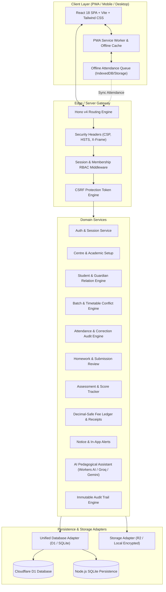
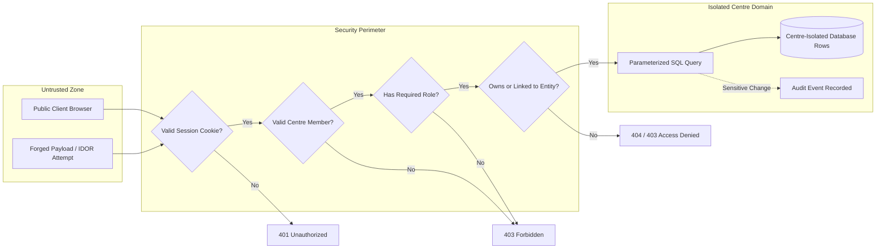

# CoachingOS — System Architecture & Design Specification

## 1. Architectural Philosophy

CoachingOS is designed around three foundational principles:
1. **Dual-Runtime Serverless / Edge & Node.js Portability**: Single codebase that runs identically on Cloudflare Workers + D1 and portable Node.js / Docker / local environments with SQLite.
2. **Strict Server-Enforced Tenant & Relationship Isolation**: No client-supplied IDs are ever trusted. Access rights are resolved entirely from cryptographic session cookies, validated memberships, and explicit database relation tables (`batch_teachers`, `student_guardians`).
3. **Decimal-Safe Financial Arithmetic**: All currency calculations are conducted in integer minor units (paise / cents), eliminating IEEE 754 floating-point inaccuracies.

---

## 2. Architecture Diagram (Mermaid)



---

## 3. Trust Boundaries & Security Model



### Trust Boundary Rules
1. **Never Trust Request Body IDs**: Even if the payload contains `centre_id`, the server replaces it with the authenticated session's `active_centre_id`.
2. **Guardian Access Guard**: A parent calling `/api/v1/students/:id/attendance` triggers a query verifying `SELECT 1 FROM student_guardians WHERE student_id = ? AND guardian_id = ?`. If missing, the request fails with 403 Forbidden.
3. **Teacher Access Guard**: A teacher cannot query batches outside of `batch_teachers`.
4. **Accountant Access Guard**: An accountant has access to invoices, payments, and fee heads, but is blocked from viewing individual exam marks or attendance sessions.

---

## 4. Multi-Runtime Database Adapter

To support both Cloudflare Workers (D1) and Node.js environments (Docker, WorkBuddy, local), the database layer uses a normalized promise-based interface:

```typescript
export interface DatabaseDriver {
  query<T = any>(sql: string, params?: any[]): Promise<T[]>;
  execute(sql: string, params?: any[]): Promise<{ rowsAffected: number; lastInsertRowid?: number }>;
  transaction<T>(fn: (tx: DatabaseDriver) => Promise<T>): Promise<T>;
}
```

- In Node.js: Uses `sql.js` (WebAssembly SQLite) with automated disk persistence in `data/coachingos.db`.
- In Cloudflare Workers: Direct binding to `env.DB` (`D1Database`).

---

## 5. Free-Tier Infrastructure Integration

| Capability | Free-Tier Provider | Integration Boundary | Fallback Behaviour |
|---|---|---|---|
| Edge Compute & Hosting | Cloudflare Workers & Static Assets / Node.js | Hono framework | Portable single-port Node service |
| Relational Storage | Cloudflare D1 (5 GB Free limit) / SQLite | SQL queries & migrations | Local SQLite file |
| Object Storage | Cloudflare R2 (10 GB Free limit) | File upload abstraction | Base64 / Local sandbox |
| AI Pedagogical Engine | Cloudflare Workers AI / Groq / Gemini Free | `AIAssistantService` adapter | Rule-based template generator |
| Email Notifications | Resend Free (3,000 emails/month) / CF Email | `EmailAdapter` interface | In-app notifications center |
| CI/CD Pipeline | GitHub Actions Free (2,000 mins/mo) | `.github/workflows/ci.yml` | Local automated test suite |
